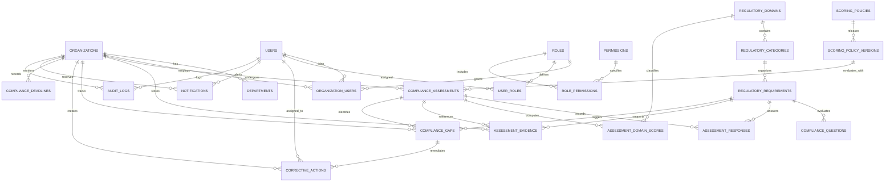

# Database Entity-Relationship Architecture (3NF)

The Compliance Risk Analytics System (CRAS) utilizes a normalized relational schema complying with Third Normal Form (3NF), ensuring multi-tenant isolation, data integrity, auditability, and deterministic compliance calculation.

## Entity Relationship Diagram

## Relational Schema Specifications

### 1. `users`
- `id` (PK, Integer, Auto-increment)
- `email` (String 180, Unique, Indexed, Not Null)
- `password_hash` (String 255, Bcrypt hash, Not Null)
- `full_name` (String 120, Not Null)
- `phone_number` (String 40, Nullable)
- `is_active` (Boolean, Default True)
- `failed_login_attempts` (Integer, Default 0)
- `locked_until` (DateTime UTC, Nullable)
- `last_login_at` (DateTime UTC, Nullable)
- `created_at`, `updated_at` (DateTime UTC)

### 2. `organizations`
- `id` (PK, Integer, Auto-increment)
- `name` (String 200, Indexed, Not Null)
- `business_registration_number` (String 80, Unique, Indexed, Not Null)
- `kra_pin` (String 30, Unique, Indexed, Not Null)
- `industry_sector` (String 100, Not Null)
- `business_type` (String 80, Not Null)
- `organization_size` (String 50, Not Null)
- `employee_count` (Integer, Not Null)
- `county` (String 80, Not Null)
- `contact_email` (String 180, Not Null)
- `is_active` (Boolean, Default True)
- `created_at`, `updated_at` (DateTime UTC)

### 3. `organization_users` (Tenant Membership & RBAC)
- `id` (PK, Integer, Auto-increment)
- `organization_id` (FK -> `organizations.id` ON DELETE CASCADE)
- `user_id` (FK -> `users.id` ON DELETE CASCADE)
- `role_id` (FK -> `roles.id` ON DELETE RESTRICT)
- `department_id` (FK -> `departments.id` ON DELETE SET NULL)
- `is_primary` (Boolean, Default False)
- Constraint: `uq_org_user (organization_id, user_id)`

### 4. `regulatory_requirements`
- `id` (PK, Integer, Auto-increment)
- `domain_id` (FK -> `regulatory_domains.id` ON DELETE CASCADE)
- `category_id` (FK -> `regulatory_categories.id` ON DELETE CASCADE)
- `code` (String 80, Unique, Indexed, Not Null)
- `title` (String 255, Not Null)
- `plain_description` (Text, Not Null)
- `legal_reference` (String 255, Not Null)
- `applicability_rule` (String 255, Default 'All registered SMEs')
- `required_evidence_desc` (Text, Nullable)
- `risk_weight` (Float, Default 1.0, Not Null)
- `potential_consequence` (Text, Nullable)
- `recommended_corrective_action` (Text, Nullable)
- `verification_status` (String 30, Default 'VERIFIED')

### 5. `compliance_assessments`
- `id` (PK, Integer, Auto-increment)
- `organization_id` (FK -> `organizations.id` ON DELETE CASCADE)
- `created_by_id` (FK -> `users.id` ON DELETE RESTRICT)
- `scoring_policy_version_id` (FK -> `scoring_policy_versions.id` ON DELETE RESTRICT)
- `title` (String 200, Not Null)
- `assessment_period` (String 80, Not Null)
- `assessment_date` (Date, Not Null)
- `status` (String 30, Default 'DRAFT')
- `overall_score` (Float, Nullable)
- `risk_classification` (String 30: 'HIGH_RISK', 'MODERATE_RISK', 'COMPLIANT')
- `total_obligations`, `compliant_count`, `partially_compliant_count`, `non_compliant_count`, `not_applicable_count` (Integer)

### 6. `compliance_gaps`
- `id` (PK, Integer, Auto-increment)
- `organization_id` (FK -> `organizations.id` ON DELETE CASCADE)
- `assessment_id` (FK -> `compliance_assessments.id` ON DELETE CASCADE)
- `requirement_id` (FK -> `regulatory_requirements.id` ON DELETE CASCADE)
- `gap_title` (String 255, Not Null)
- `gap_description` (Text, Not Null)
- `legal_reference` (String 255, Not Null)
- `potential_consequence` (Text, Nullable)
- `recommended_action` (Text, Nullable)
- `severity` (String 20: 'CRITICAL', 'HIGH', 'MEDIUM', 'LOW')
- `status` (String 30: 'OPEN', 'ASSIGNED', 'IN_PROGRESS', 'RESOLVED', 'CLOSED')

### 7. `corrective_actions`
- `id` (PK, Integer, Auto-increment)
- `organization_id` (FK -> `organizations.id` ON DELETE CASCADE)
- `gap_id` (FK -> `compliance_gaps.id` ON DELETE CASCADE)
- `assessment_id` (FK -> `compliance_assessments.id` ON DELETE CASCADE)
- `assigned_to_id` (FK -> `users.id` ON DELETE SET NULL)
- `created_by_id` (FK -> `users.id` ON DELETE RESTRICT)
- `title` (String 255, Not Null)
- `action_description` (Text, Not Null)
- `priority` (String 20: 'CRITICAL', 'HIGH', 'MEDIUM', 'LOW')
- `status` (String 30: 'OPEN', 'ASSIGNED', 'IN_PROGRESS', 'PENDING_VERIFICATION', 'RESOLVED', 'CLOSED')
- `due_date` (Date, Not Null)
- `resolution_notes` (Text, Nullable)

